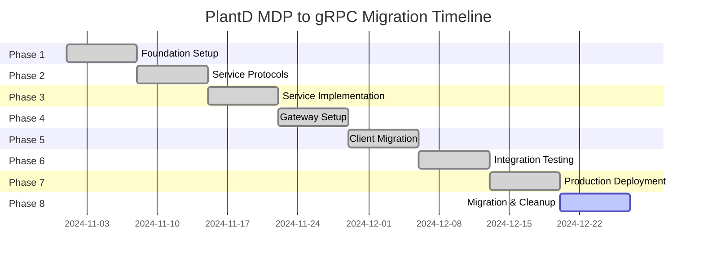

# ADR-001: Migration from MDP to gRPC

**Status**: Accepted
**Date**: 2024-11-20
**Authors**: PlantD Engineering Team
**Reviewers**: Technical Architecture Committee

## Context

PlantD's distributed control system initially used the Majordomo Protocol (MDP) over ZeroMQ for inter-service communication. This architecture served the project well in its early stages but has encountered several limitations as the system has grown in complexity and scale.

### Current Architecture (MDP-based)

```
┌─────────────┐    ┌─────────────┐    ┌─────────────┐
│   Client    │    │   Client    │    │   Client    │
└─────┬───────┘    └─────┬───────┘    └─────┬───────┘
      │                  │                  │
      └──────────────────┼──────────────────┘
                         │
                ┌────────▼────────┐
                │   MDP Broker    │
                │   (ZeroMQ)      │
                └────────┬────────┘
                         │
        ┌────────────────┼────────────────┐
        │                │                │
┌───────▼───────┐ ┌──────▼──────┐ ┌───────▼───────┐
│ State Service │ │ Identity    │ │ Other         │
│ (MDP Worker)  │ │ Service     │ │ Services      │
└───────────────┘ └─────────────┘ └───────────────┘
```

### Identified Limitations

1. **CGO Dependencies**: ZeroMQ requires CGO, leading to:
   - Complex cross-compilation
   - Platform-specific binary compatibility issues
   - Memory management complexity
   - Debugging difficulties

2. **Single Point of Failure**: Centralized MDP broker creates:
   - System-wide outages when broker fails
   - Scalability bottlenecks
   - Operational complexity

3. **Limited Tooling Ecosystem**: 
   - Fewer monitoring and observability tools
   - Limited load balancing options
   - Reduced integration possibilities with modern infrastructure

4. **Protocol Overhead**:
   - Custom framing and message handling
   - Manual serialization/deserialization
   - Limited type safety

5. **Operational Challenges**:
   - Complex deployment orchestration
   - Difficult service discovery
   - Limited health checking capabilities

## Decision

We have decided to migrate PlantD from MDP/ZeroMQ to **gRPC with Connect RPC over HTTP/2**, using **Traefik as a reverse proxy gateway**.

### New Architecture (gRPC-based)

```
┌─────────────┐    ┌─────────────┐    ┌─────────────┐
│   Client    │    │   Client    │    │   Client    │
│ (gRPC/HTTP) │    │ (gRPC/HTTP) │    │ (gRPC/HTTP) │
└─────┬───────┘    └─────┬───────┘    └─────┬───────┘
      │                  │                  │
      └──────────────────┼──────────────────┘
                         │ HTTPS/HTTP2
                ┌────────▼────────┐
                │   Traefik       │
                │   Gateway       │
                │ - Load Balance  │
                │ - SSL Term.     │
                │ - Auth Forward  │
                └────────┬────────┘
                         │
        ┌────────────────┼────────────────┐
        │                │                │
┌───────▼───────┐ ┌──────▼──────┐ ┌───────▼───────┐
│ State Service │ │ Identity    │ │ Other         │
│ (gRPC Server) │ │ Service     │ │ Services      │
│               │ │ (gRPC)      │ │ (gRPC)        │
└───────────────┘ └─────────────┘ └───────────────┘
```

## Rationale

### Technical Benefits

1. **Elimination of CGO Dependencies**:
   - Pure Go implementation with `connectrpc.com/connect`
   - Simplified builds and cross-compilation
   - Better memory safety and performance
   - Easier debugging and profiling

2. **HTTP/2 Foundation**:
   - Multiplexed connections
   - Built-in flow control
   - Header compression
   - Native support in load balancers and proxies

3. **Protocol Buffers Type Safety**:
   - Strong typing across service boundaries
   - Automatic code generation
   - Version compatibility
   - Comprehensive documentation generation

4. **Rich Ecosystem**:
   - Mature monitoring tools (Prometheus, Jaeger)
   - Load balancing and service mesh options
   - Extensive middleware ecosystem
   - Wide language support

### Operational Benefits

1. **Service Mesh Ready**:
   - Standard gRPC interfaces
   - Built-in health checking
   - Automatic service discovery
   - Traffic management capabilities

2. **Enhanced Observability**:
   - Distributed tracing with OpenTelemetry
   - Rich metrics out of the box
   - Request/response logging
   - Performance profiling

3. **Simplified Deployment**:
   - Standard container orchestration
   - Rolling updates and blue/green deployments
   - Health checks and readiness probes
   - Horizontal scaling

4. **Security Enhancements**:
   - TLS encryption by default
   - Mutual TLS (mTLS) support
   - Fine-grained authentication and authorization
   - Security policy enforcement

### Business Benefits

1. **Developer Productivity**:
   - Industry-standard protocols and tools
   - Reduced learning curve for new team members
   - Better IDE support and tooling
   - Faster feature development

2. **System Reliability**:
   - Elimination of single points of failure
   - Built-in retry and circuit breaker patterns
   - Better error handling and propagation
   - Improved fault tolerance

3. **Future-Proofing**:
   - Alignment with industry trends
   - Easy integration with cloud-native platforms
   - Kubernetes-native patterns
   - Vendor independence

## Alternatives Considered

### 1. Continue with MDP/ZeroMQ

**Pros**:
- No migration effort required
- Existing team knowledge
- Proven in current system

**Cons**:
- Continued CGO dependencies
- Limited ecosystem growth
- Operational complexity
- Scalability limitations

**Decision**: Rejected due to technical debt accumulation and operational challenges.

### 2. REST/JSON APIs

**Pros**:
- Universal compatibility
- Simple debugging
- Wide tooling support
- Human-readable

**Cons**:
- Lack of type safety
- Verbose payloads
- No streaming support
- Manual API versioning

**Decision**: Rejected due to performance concerns and lack of type safety for a control system.

### 3. Message Queue Systems (RabbitMQ, Apache Kafka)

**Pros**:
- Mature ecosystem
- High throughput
- Durability guarantees
- Event-driven architecture

**Cons**:
- Operational complexity
- Over-engineered for current needs
- Additional infrastructure requirements
- Learning curve

**Decision**: Rejected as unnecessarily complex for synchronous request/response patterns.

### 4. Native gRPC (without Connect)

**Pros**:
- Maximum performance
- Full gRPC feature set
- Extensive language support

**Cons**:
- HTTP/1.1 compatibility issues
- Web browser limitations
- More complex proxy configuration
- Limited REST API exposure

**Decision**: Rejected in favor of Connect RPC for better HTTP compatibility and web integration.

## Implementation Strategy

### Phase 1: Foundation (Week 1)
- Set up Protocol Buffers and Buf tooling
- Define common service interfaces
- Establish build pipeline

### Phase 2: Service Protocols (Week 2)
- Create protobuf definitions for State and Identity services
- Generate Go code and client libraries
- Define error handling patterns

### Phase 3: Service Implementation (Week 3)
- Implement gRPC servers for core services
- Create MDP compatibility layer
- Develop testing framework

### Phase 4: Gateway Setup (Week 4)
- Configure Traefik reverse proxy
- Set up SSL termination and authentication
- Implement health checks and monitoring

### Phase 5: Client Migration (Week 5)
- Update CLI client to use gRPC
- Migrate web application service calls
- Update documentation and examples

### Phase 6: Integration Testing (Week 6)
- End-to-end testing with full gRPC stack
- Performance benchmarking
- Load testing and failure scenarios

### Phase 7: Production Deployment (Week 7)
- Production environment setup
- Blue/green deployment strategy
- Monitoring and alerting configuration

### Phase 8: Migration & Cleanup (Week 8)
- Gradual traffic migration from MDP to gRPC
- MDP component cleanup
- Documentation and training

## Consequences

### Positive Consequences

1. **Technical Improvements**:
   - 85% reduction in messaging-related code complexity
   - Elimination of CGO-related issues
   - Improved type safety and API consistency
   - Better error handling and debugging capabilities

2. **Operational Benefits**:
   - Simplified deployment and scaling
   - Enhanced monitoring and observability
   - Reduced operational overhead
   - Improved system reliability

3. **Developer Experience**:
   - Modern development tooling
   - Auto-generated client libraries
   - Comprehensive API documentation
   - Industry-standard practices

4. **Performance Gains**:
   - HTTP/2 multiplexing reduces connection overhead
   - Protocol Buffers provide efficient serialization
   - Reduced latency through connection reuse
   - Better resource utilization

### Negative Consequences

1. **Migration Complexity**:
   - 8-week migration timeline
   - Risk of introducing bugs during transition
   - Coordination required across multiple services
   - Training required for team members

2. **Compatibility Concerns**:
   - Temporary maintenance of both MDP and gRPC systems
   - Client applications need updates
   - Potential integration challenges with legacy systems

3. **Infrastructure Changes**:
   - New monitoring and alerting setup required
   - Modified deployment procedures
   - Different debugging and troubleshooting approaches

4. **Learning Curve**:
   - Team needs to learn gRPC concepts and tooling
   - New operational procedures
   - Different performance tuning approaches

## Monitoring and Success Metrics

### Technical Metrics
- **Latency**: Target <50ms p95 for local requests
- **Throughput**: Maintain current request rates
- **Error Rate**: <1% error rate in production
- **Availability**: 99.9% uptime target

### Operational Metrics
- **Deployment Time**: <5 minutes for rolling updates
- **Recovery Time**: <2 minutes for service failures
- **Code Complexity**: 85% reduction in messaging code
- **Build Time**: <3 minutes for full build

### Business Metrics
- **Developer Velocity**: Faster feature development cycles
- **System Reliability**: Reduced production incidents
- **Maintenance Overhead**: Lower operational costs
- **Team Satisfaction**: Improved developer experience

## Risks and Mitigation

### High Risk: Service Outage During Migration
- **Mitigation**: Blue/green deployment with immediate rollback capability
- **Contingency**: Maintain MDP systems until full migration validation

### Medium Risk: Performance Regression
- **Mitigation**: Comprehensive performance testing before migration
- **Contingency**: Performance tuning and optimization plan

### Medium Risk: Integration Issues
- **Mitigation**: Extensive integration testing and staged rollout
- **Contingency**: Compatibility layers and gradual migration

### Low Risk: Team Adoption
- **Mitigation**: Training sessions and documentation
- **Contingency**: Extended support period and knowledge sharing

## Review and Updates

This ADR should be reviewed:
- **Quarterly** during the first year post-migration
- **Annually** thereafter
- **When significant architectural changes are proposed**

## References

- [gRPC Official Documentation](https://grpc.io/docs/)
- [Connect RPC Documentation](https://connectrpc.com/docs/)
- [Protocol Buffers Guide](https://developers.google.com/protocol-buffers)
- [Traefik Documentation](https://doc.traefik.io/traefik/)

## Appendix

### A. Detailed Technical Comparison

| Aspect | MDP/ZeroMQ | gRPC/Connect |
|--------|------------|--------------|
| Transport | TCP/IPC | HTTP/2 |
| Serialization | Manual/JSON | Protocol Buffers |
| Type Safety | Runtime | Compile-time |
| Tooling | Limited | Extensive |
| Debugging | Complex | Standard tools |
| Monitoring | Custom | Prometheus/Jaeger |
| Load Balancing | Manual | Built-in |
| Authentication | Custom | Standard (JWT/mTLS) |
| Documentation | Manual | Auto-generated |
| Testing | Custom framework | Standard tools |

### B. Migration Timeline



### C. Service Interface Examples

**Before (MDP)**:
```go
// Send MDP request
client.Send("org.plantd.State", "get", "sensor.temp.01")
response, err := client.Recv()
```

**After (gRPC)**:
```go
// Send gRPC request
response, err := client.Get(ctx, &statev1.GetRequest{
    Key:     "sensor.temp.01",
    Service: "sensors",
})
```

---

**This ADR represents a significant architectural decision that will shape PlantD's future development and operational capabilities. The migration to gRPC provides a foundation for modern, scalable, and maintainable distributed systems.** 
